<p align="center">
  <a href="https://sakisaki-dev.github.io/RetroVault/">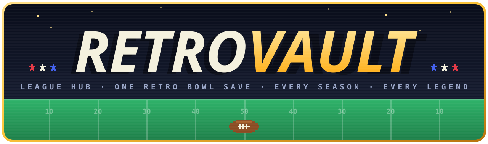</a>
</p>

<p align="center">
  <a href="https://sakisaki-dev.github.io/RetroVault/"></a>
</p>
<p align="center">
  
  
  
  
  
  
  
</p>

**Retro Vault** is a static, phone-first analytics platform for a long-running football league. Raw game
screenshots go in; a validated dataset, a few dozen derived metrics, generated news, a card economy with a market,
ten data-driven games and an iOS home-screen widget come out. There is no server: a reproducible build pipeline
compiles everything into JSON, and the React app reads it from GitHub Pages.

The interesting part is underneath the UI:

- **An append-only, event-sourced data model.** Every change is a mutation in an idempotent upload bundle with
  its source, reason and trigger logged.
- **A deterministic build.** Two runs produce byte-identical output, so every derived number traces back to a rule.
- **An audit layer.** Validation and consistency checks make a bad datum stop the pipeline instead of reaching
  the site.
- **A fact-checker for generated prose.** Every number in a news article must cite a source path that resolves
  to that exact value.

The bundled dataset is a single Retro Bowl league: 88 seasons, 203 player careers, 32 clubs and every Super Bowl.

<p align="center"><b><a href="https://sakisaki-dev.github.io/RetroVault/">▶ Try the live demo</a></b> · installable on a phone home screen</p>

---

## Contents

- [Architecture](#%EF%B8%8F-architecture)
- [Analytics and modelling](#-analytics-and-modelling)
- [Data quality](#-data-quality)
- [Features](#-features)
- [Frontend engineering](#%EF%B8%8F-frontend-engineering)
- [Running it](#-running-it)
- [Repository map](#%EF%B8%8F-repository-map)

---

## 🏗️ Architecture

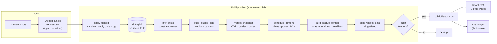

**Data in, everything else generated.** `data/y80/` holds only facts: career lines, awards, Super Bowls, coach
seasons, the record board, rosters and weekly scores. Everything that reads like analysis is produced by a rule in
`scripts/`, never typed by hand: eras, rivalries, storylines, Hall of Fame classes, career stints, power rankings
and headlines.

**Event-sourced ingestion.** Each upload is a bundle (`data/uploads/<date>-<slug>/manifest.json`) of typed
mutations such as `player.set`, `superbowl.set`, `coach.season`, `fact.set`, `schedule.set` and `story.set`.
Each mutation must carry a source (`image:<file>`, `owner` or `data:<files>`), a reason and a trigger. A bundle
applies exactly once (its id is logged in `mutations_log.json`), so the whole dataset can be replayed from its
history.

**Reproducible builds.** `npm run rebuild` runs seven stages in a fixed order. Output is deterministic: sorted
keys, stable tie-breaks and seeds derived from content hashes (FNV-1a) rather than clocks. Re-running the
pipeline on unchanged data produces no diff, which makes code review of generated data possible.

**Static delivery.** The SPA is code-split, hash-routed and deployed by a GitHub Actions workflow on every push.
Data files are revalidated on each load (`cache: 'no-cache'` with ETags), so even an installed home-screen web
app picks up a new build without stale state.

**Constrained generative AI.** Exactly three lanes are model-written: Hall of Fame speeches, per-season news
packages and card art. Each is stored as a mutation and checked by code: speeches for length, style and numbers;
stories by a source-resolving fact-checker. Nothing else in the system depends on a model.

---

## 📊 Analytics and modelling

All formulas are documented in [`docs/STATS_REFERENCE.md`](docs/STATS_REFERENCE.md).

| Model | What it does | Where |
|---|---|---|
| **Position-normalized talent** | Per-position *True Talent* formulas are rescaled so each position's top-3 benchmark lands on a common reference, making a lineman comparable to a quarterback. Linemen use diminishing returns on volume (√blocks) plus a shrunk per-game rate (blocks / (games + 50)), so a short hot streak can't dominate. | `src/config/stats.ts`, `scripts/build_league_data.py` |
| **Career Legacy** | A composite of talent, award-weighted *Dominance* and longevity, used for Hall of Fame thresholds and tiers. | `src/config/stats.ts` |
| **OVR** | A percentile within the position pool mapped through a power curve: `62 + 37 · pct^0.85`. | `src/config/ovr.ts` |
| **Skill grades** | Rate-based play-style traits (accuracy, explosiveness, ball security…) graded S–F by per-position percentile, with minimum-sample rules so small samples never set the scale. | `src/config/skillGrades.ts` |
| **Similarity search** | Nearest neighbours over standardized play-style feature vectors ("who plays like him"). | `src/config/advanced.ts` |
| **Value Over Replacement** | League Score above the 20th-percentile replacement level at each position. | `src/config/advanced.ts` |
| **Career stint inference** | Reconstructs which club a player was on each season with no per-season data: a search over ordered, contiguous stints, constrained so championships won during each stint equal his rings, pinned by record-board and roster anchors and scored on games-per-season fit. Output carries a confidence level and templated evidence; ambiguous cases become open questions. | `scripts/infer_stints.py` |
| **Era segmentation** | Splits coaching history at 3+ title-less seasons and merges short runs into named eras. | `scripts/build_league_content.py` |
| **Power rankings** | `100 × win% + 1.5 × point differential per game + 40 × (SOS − 0.5)`, where strength of schedule is the opponents' mean final win %. Also the upset of the year (largest win % gap overcome), head-to-head records and game records. | `scripts/schedule_content.py` |
| **Card market** | Every rating change appends a snapshot; prices are value × finish × variant multipliers, with risers, fallers and a portfolio history. | `scripts/market_snapshot.ts`, `src/utils/cardMarket.ts` |
| **Pack odds** | Layered rarity (tier × finish × art variant, with stacking penalties), verified by a Monte Carlo simulator over hundreds of thousands of packs. | `src/utils/collection.ts`, `scripts/simulate_packs.ts` |
| **Headline ranking** | Diffs consecutive snapshots into weighted news items (milestones crossed, grade changes, movers ≥ 5%, record chases ≥ 85%), capped per player and ranked deterministically. | `build_headlines()` |

---

## ✅ Data quality

Bad data is designed to fail loudly, before it reaches the site.

- **Monotonic invariants.** Career totals can only increase, so a drop is rejected as a misread unless it is
  explicitly re-checked and flagged (`_allow_decrease`).
- **Cross-source reconciliation.** Weekly scores must reconcile with the standings: every team's W-L-T recomputed
  from 272 games has to match. Unknown clubs and a team playing twice in a week are refused.
- **The audit (`npm run audit`).** It runs after every build and checks provenance on every mutation, owner text
  matching its manifest verbatim, every Hall of Famer having exactly one speech, banners matching rosters, widget
  freshness, and stale numbers in generated prose. Errors block the pipeline; warnings are reported.
- **A fact-checker for generated text (`scripts/story_check.py`).** Every number in a headline or paragraph must
  appear in that article's `stats[]` with a source expression that resolves against the data, using a small path
  language, for example:
  ```text
  players.json RB:Ryland Maxwell ryds                        a career total
  market_history.json snapA..snapB WR:Apollo Adam s.yds      a change between two snapshots
  schedule.json seasons/Y88/table/[abbr=PHI]/pf              a generated table cell
  records.json Best rushing season mark  minus  players…     a gap between two figures
  ```
  A stored story whose cited figure later drifts from the data is flagged as stale.
- **A screenshot ledger (`npm run ledger`).** Content-addressed (SHA-256) records of every source image, with
  what it showed and which bundle consumed it, so duplicates are found and source files can be pruned safely.

---

## 🎮 Features

### Arcade: ten games generated from the data

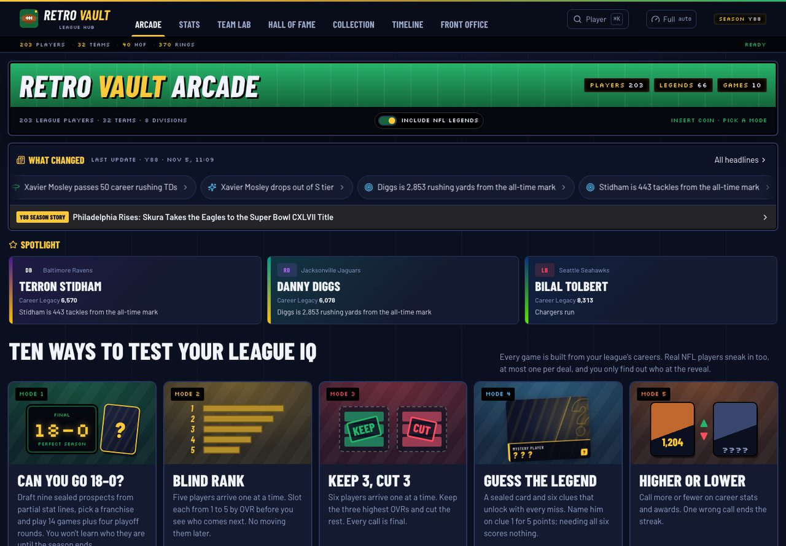

Every game is built from real career data, with a pool of 66 real NFL legends mixed in:

| | | |
|---|---|---|
| 🏈 **Can you go 18-0?** A season simulator: opponents' ratings blend each club's real power score with a random roll | 📊 **Blind Rank** Order five players by OVR, one at a time | ✂️ **Keep 3, Cut 3** Keep the three highest OVRs |
| 🕵️ **Guess the Legend** Six progressive clues | ⬆️⬇️ **Higher or Lower** Streaks on career stats and awards | 🔢 **League Grid** A 3×3 constraint puzzle over real careers |
| 🎭 **Who's the Imposter?** Five players share a hidden trait | 🔗 **Six Degrees** Path-finding through teammates, eras and lineages, scored against par | 🎯 **Over/Under** Career prop lines with parlays |
| 🧪 **Build-a-Legend** Assemble traits, then a similarity search finds who it plays like | | |

### Stats hub: record book, graph builder, deep dive

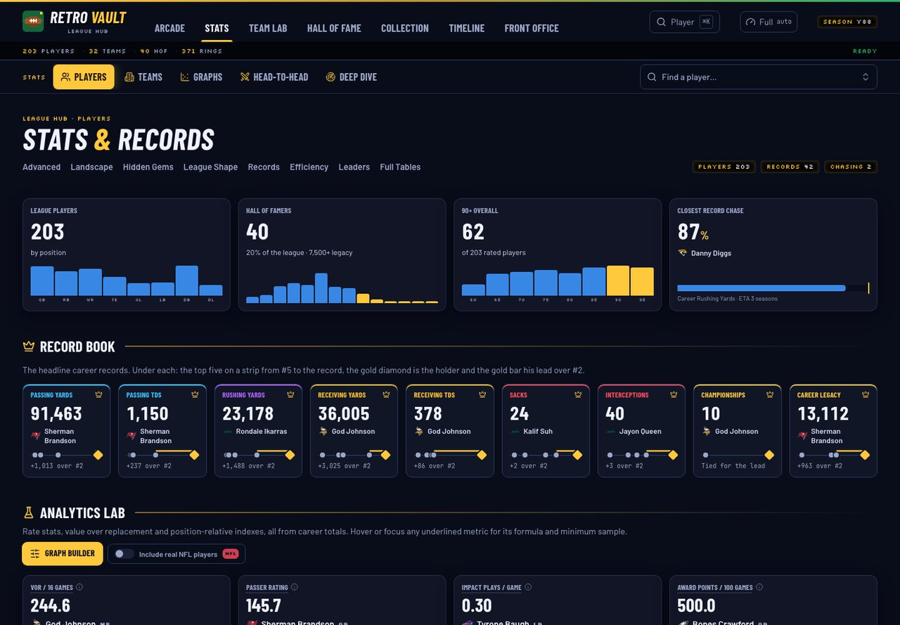

A record book with chase bars, leaderboards and efficiency boards with minimum samples, and an analytics lab. The
**Graph Builder** plots any metric against any other, with medians, quadrants and trend lines:

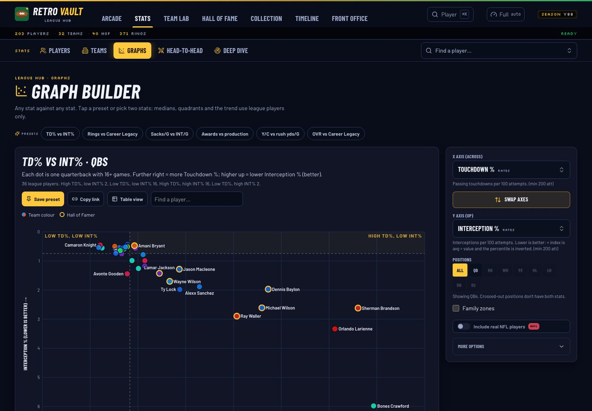

The **Deep Dive** is a per-player scouting report: skill grades, similar players, career arcs and awards.

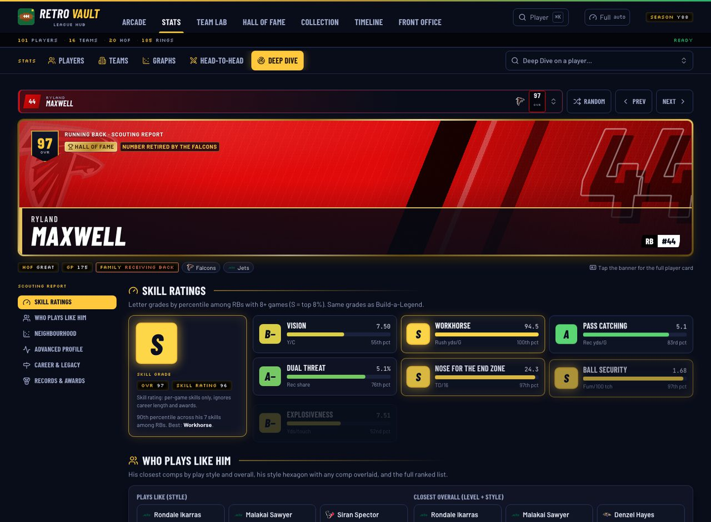

### Teams, Hall of Fame and Front Office

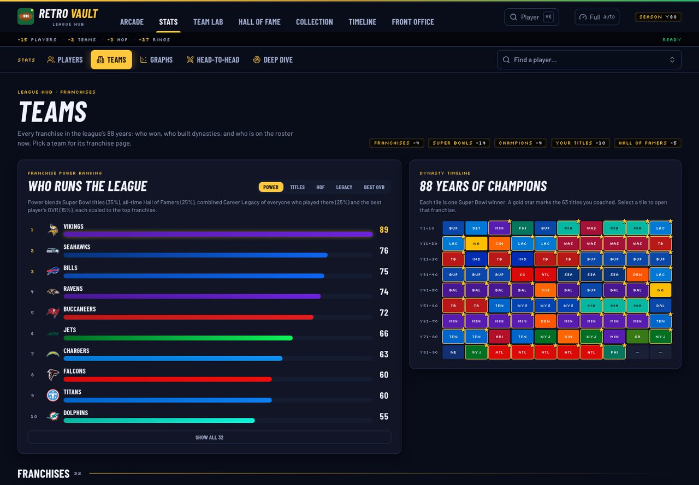

A franchise power index and a champions heat map; a Hall of Fame with tiers, classes and induction ceremonies; and
a front-office view of coaching records, the trophy cabinet and rivalries with head-to-head results.

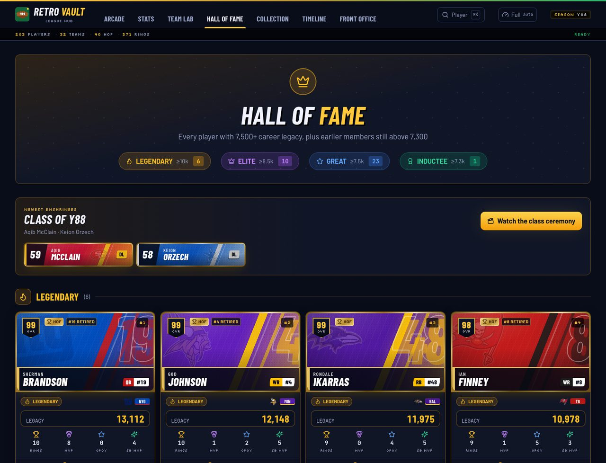

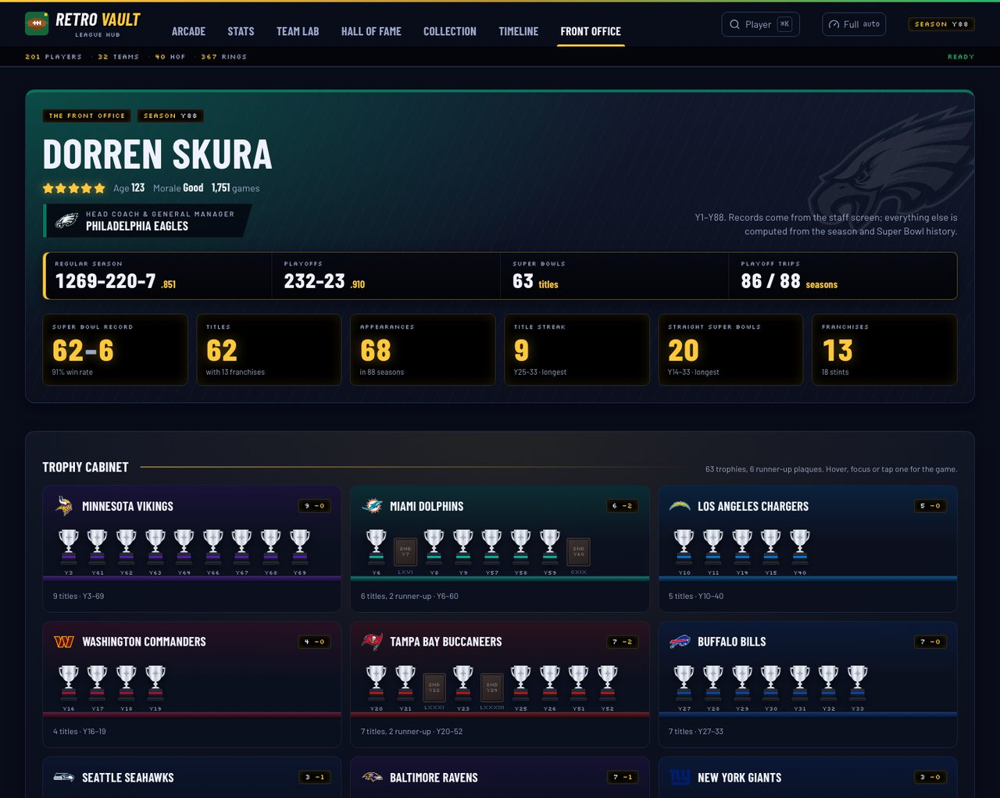

### Timeline: generated news and season analytics

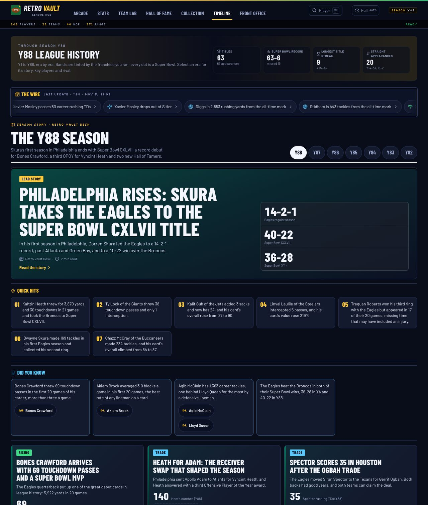

Era-by-era history, **The Wire** (rule-ranked headlines), and a per-season news package that passes the
fact-checker. Below it, **Season games** renders the schedule model: a week-by-week game log, power rankings,
standings, notable games and game records.

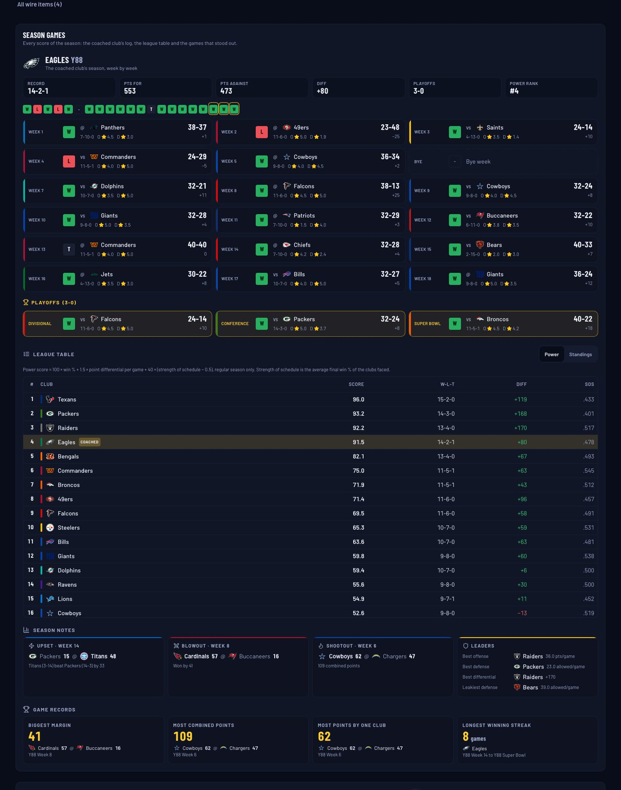

### Collection: a card economy

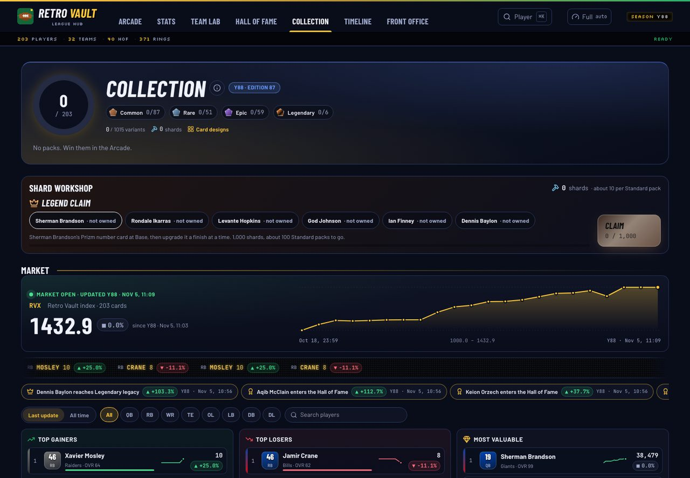

Every player is a card with layered rarity: tier, finish and art variant. Packs are earned in the games,
duplicates convert to shards for targeted crafting, and a market tracks value over time with a portfolio view.

### Team Lab

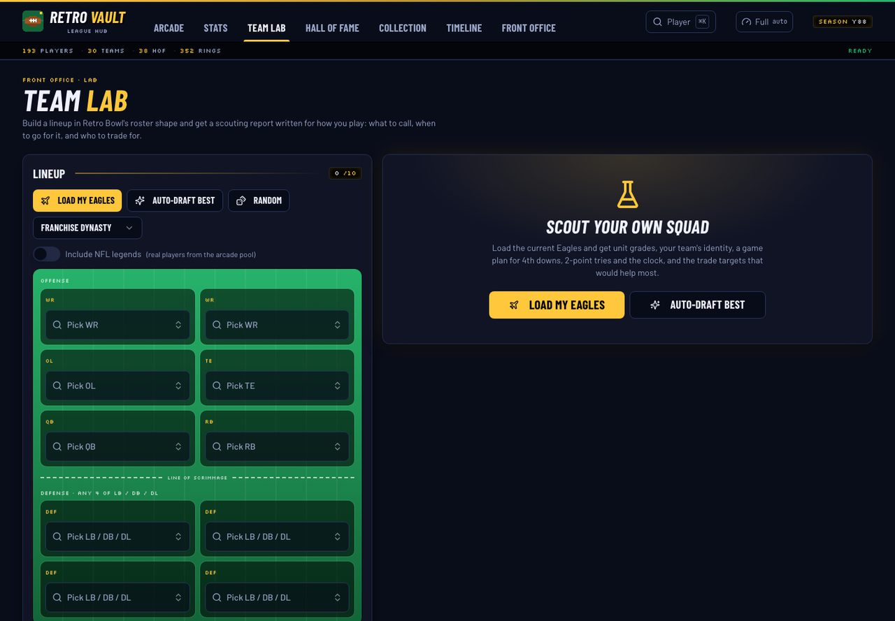

A lineup builder that grades each unit and produces a game plan and trade targets from the roster's numbers.

### Mobile and the iOS widget

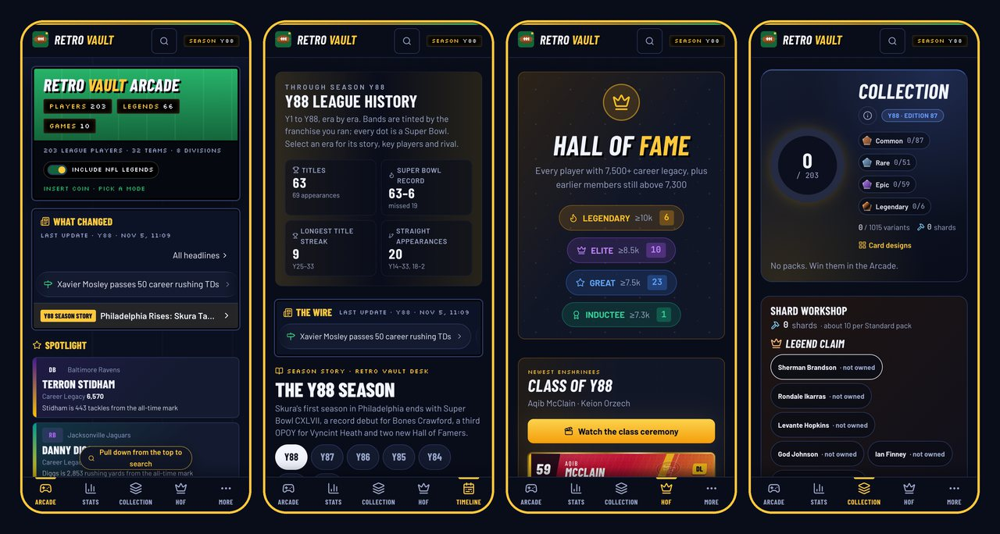

Phone-first layouts with no horizontal scroll at 390 px. A **Scriptable widget**
(`public/widgets/retro-vault-widget.js`) renders every iOS widget family from one ~70 KB JSON feed, from the lock
screen to large. It draws with `DrawContext`, rotates content on a seeded shuffle and computes club colours that
meet a WCAG 4.5:1 contrast ratio against its backgrounds.

---

## 🖥️ Frontend engineering

- **React and TypeScript** with strict types for every data contract (`src/utils/leagueContent.ts`,
  `src/utils/schedule.ts`), hash routing with deep links (`#stats/deepdive?p=QB:Name`) and lazy-loaded tabs.
- **Procedural card art** in SVG: jersey, vintage and locker-room styles in team palettes, with an Art Lab for
  iterating on designs.
- **Edition seeding.** Rotating presentation choices (featured players, spotlight order, accent colours) key off a
  hash of the latest upload, so the site looks fresh after each update but never changes between rebuilds. Card
  identity never uses it.
- **Caching strategy.** Every data fetch revalidates; local overrides, such as player edits kept in IndexedDB,
  yield to newer source data, determined by monotonic career totals.
- **Accessibility.** Real table markup, `aria-pressed` toggles and contrast-checked team colours.

---

## 🚀 Running it

```bash
git clone https://github.com/sakisaki-dev/RetroVault.git
cd RetroVault
npm install
npm run dev              # dev server with hot reload
```

| Command | Purpose |
|---|---|
| `npm run rebuild` | Run the full pipeline from `data/y80/` and audit it |
| `npm run update -- data/uploads/<bundle>` | Validate and apply a bundle, rebuild, typecheck, build and summarize |
| `npm run apply-upload -- <bundle> --check` | Dry-run validation of a bundle |
| `npm run audit` | Consistency checks only |
| `npm run sim:packs` | Monte Carlo pack-odds simulation |
| `npm run ledger` | Rebuild the screenshot ledger (`-- --clean` lists files safe to prune) |
| `npm run build` | Production build (CI runs this on every push) |

---

## 🗂️ Repository map

```text
RetroVault/
├─ data/
│  ├─ y80/            source of truth: players, coach, super_bowls, records, schedules, owner_facts,
│  │                  speeches, stories, market_history, mutations_log, screenshots ledger
│  └─ uploads/        one bundle per upload (manifest.json; source images stay local)
├─ scripts/           pipeline: apply_upload · update · infer_stints · build_league_data · market_snapshot ·
│                     schedule_content · build_league_content · build_widget_data · audit · story_check ·
│                     simulate_packs · screenshot_ledger
├─ public/
│  ├─ data/           generated JSON the app reads (league CSV, content, schedule, market, widget)
│  └─ widgets/        Scriptable iOS widget
├─ src/
│  ├─ config/         metric definitions: stats, OVR, skill grades, similarity
│  ├─ utils/          typed loaders, market, collection economy, editions
│  └─ components/     tabs, games, collection and Art Lab, news, timeline, front office
├─ docs/              STATS_REFERENCE.md (every formula), game mechanics, README assets
└─ .github/workflows/ Pages deploy
```

---

## 🙏 Credits

Initial UI prototyping was assisted by [Lovable](https://www.lovable.dev). The architecture, data pipeline,
analytics, persistence and application logic were designed and implemented by the author.

A fan project, not affiliated with New Star Games (*Retro Bowl*) or any league or team; names and logos belong to
their owners.

**Saketh Machiraju** · Computer Science student · samachir@ucsc.edu

<p align="center"></p>
