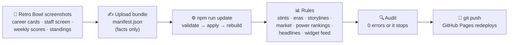

<p align="center">
  <a href="https://sakisaki-dev.github.io/RetroVault/"></a>
</p>

<p align="center">
  <a href="https://sakisaki-dev.github.io/RetroVault/"></a>
</p>
<p align="center">
  
  
  
  
  
</p>

---

> **PREVIOUSLY, ON RETRO VAULT…**
>
> One coach. One save file. **Eighty-eight seasons.**
>
> Dorren Skura has run thirteen franchises, from the Dolphins of Y1 through the Buccaneers, Bills, Ravens and Vikings
> dynasties to the perfect 17-0 Falcons, and he is now in Philadelphia, where his first Eagles team won Super Bowl CXLVII. Along the way: **63
> championships**, a Hall of Fame of 40 legends, a ring-chasing running back named Ryland Maxwell who keeps
> rewriting the record board, and an arcade full of games built from every career that ever crossed his sideline.
>
> Retro Vault is where all of it lives. Feed it Retro Bowl screenshots and it hands back a whole league:
> stats, eras, rivalries, a card market, a newspaper and a widget for your phone's home screen.

<p align="center"><b><a href="https://sakisaki-dev.github.io/RetroVault/">▶ Open the Vault</a></b> · works on a phone · add it to your home screen</p>

---

## 🕹️ The tour

### Arcade: ten ways to test your league IQ


The front door. **What Changed** ticks through the latest news, the Season Story headline sits under it, and a
spotlight rotates through the league's hottest names. Then pick a cabinet:

| | | |
|---|---|---|
| 🏈 **Can you go 18-0?** Draft sealed prospects, then play a season against clubs rated on their real form | 📊 **Blind Rank** Slot five players 1 to 5 by OVR, no take-backs | ✂️ **Keep 3, Cut 3** Six players, three survive |
| 🕵️ **Guess the Legend** One mystery card, six clues | ⬆️⬇️ **Higher or Lower** One wrong call ends the streak | 🔢 **League Grid** Nine cells, each needing a player who fits the row and the column |
| 🎭 **Who's the Imposter?** Five players share a hidden trait; find the one who doesn't | 🔗 **Six Degrees of Ikarras** Link any player to the greatest back ever | 🎯 **Over/Under** Five career prop lines: take the over or the under, or parlay all five |
| 🧪 **Build-a-Legend** Pull the lever, steal traits, see who your creation plays like | | |

Real NFL legends (66 of them) sneak into the games. They never touch league stats or the card collection.

### Stats & Records: the record book, the graph lab, the deep dive


Every career on one page: the record book (91,463 passing yards for Sherman Brandson, 23,178 rushing for
Rondale Ikarras…), leaders, efficiency boards and an analytics lab. The **Graph Builder** plots any stat against
any other:


And the **Deep Dive** opens a full scouting report on one player: skill grades, players who play like him,
career arcs and awards.


### Teams: who runs the league


A franchise power index (titles, Hall of Famers, Career Legacy) and a heat map of 88 years of champions.

### Hall of Fame: Career Legacy 7,500 and up


Forty members, sorted into Legendary, Elite, Great and Inductee. Each class gets a ceremony, and each member gets
an induction speech.

### Collection: open packs, chase variants, play the market


Every league player is a card, with 1,015 variants across four rarities. Win packs in the Arcade, smash
duplicates into shards, claim a Legend, and watch a live card market where every update moves the prices.

### Timeline: the newspaper and the season games


The league's history era by era, **The Wire** (rule-built headlines), and the **Season Story**: a full news
package written after every season, with a lead, features, trades, rises and falls, quick hits and Did You Know
facts. Every number in it is checked against the data before it can be published.

Underneath sits **Season games**: the coach's week-by-week log, power rankings for all 32 clubs, the standings,
the upset of the year and the game records.


### Front Office: the coach's résumé


Skura's record (1,269-220-7 in the regular season, 63-6 in Super Bowls), the trophy cabinet for every club he has
coached, his eras, his rivals with head-to-head records, and the players who defined each stop.

### Team Lab: scout your own squad


Load the current Eagles or draft a lineup, and get unit grades, a team identity, a game plan for 4th downs and
2-point tries, and the trade targets that would help most.

### In your pocket


The whole Vault is built phone-first: add it to the home screen and it feels like an app. There is also a
**Scriptable widget** for the iPhone (`public/widgets/`) in every size from the lock screen to large. It shows the
latest Season Story, a spotlight player, the market, The Wire, Hall of Fame watch, record chases and a Did You
Know fact a day, all in the club colours.

---

## 📼 How a season gets into the Vault

The house rule: **data goes in, everything else is generated.**



1. **Transcribe.** Every screenshot is read into structured mutations: career lines, awards, Super Bowls,
   coach seasons, the record board, rosters and weekly scores. Career totals only go up, so a total that drops is
   refused as a misread.
2. **Apply.** One bundle is one upload, applied exactly once, with its source logged for every change.
3. **Rebuild.** Deterministic rules regenerate everything else: career stints (by ring arithmetic), eras,
   rivalries, storylines, the card market, Hall of Fame classes, power rankings, The Wire and the widget feed. Two
   runs give byte-identical output.
4. **Audit.** Hundreds of checks: every Hall of Famer has a speech, every story number still matches the data,
   every banner wears the right club, no stale widget. Any error stops the update.
5. **Ship.** Push, and Pages redeploys in about two minutes.

**Exactly three things are written by AI**, and each is checked like everything else: the **Hall of Fame
speeches**, the **Season Story** news packages, and the **card art** in the Art Lab. Everything that reads like
analysis comes out of a rule in `scripts/`.

---

## 📈 By the numbers (as of Y88)

| | |
|---|---|
| 🗓️ Seasons coached | **88**, across 13 clubs (now the Eagles) |
| 🏆 Super Bowl titles | **63** (63-6 in the big game) |
| 🃏 League cards | **203**, plus 66 real NFL legends in the arcade |
| 🏛️ Hall of Famers | **40**, each with a speech |
| 📰 Season Stories | **7** seasons, 72 articles |
| 📦 Uploads applied | **87** bundles |
| 💹 Market snapshots | **22** |
| 🏟️ Weekly scores | **272** games (Y88) and counting |

---

## 🛠️ Under the hood

**Site:** React, TypeScript, Vite, Tailwind, shadcn/ui and Radix, hash-routed and served by GitHub Pages.
**Pipeline:** Python and TypeScript scripts in `scripts/` turn `data/y80/` into the bundled files in `public/data/`.

```text
RetroVault/
├─ data/
│  ├─ y80/              # the source of truth: players, coach, Super Bowls, records, schedules, owner facts,
│  │                    #   speeches, stories, market history, the mutation log, the screenshot ledger
│  └─ uploads/          # one folder per upload bundle (manifest.json; screenshots stay local, never in git)
├─ scripts/             # apply_upload · update · infer_stints · build_league_data · market_snapshot ·
│                       #   schedule_content · build_league_content · build_widget_data · audit · story_check
├─ public/
│  ├─ data/             # generated: league CSV, content.json, schedule.json, market.json, widget.json, sprites
│  └─ widgets/          # the Scriptable iPhone widget
├─ src/
│  ├─ components/       # tabs, arcade games, collection & Art Lab, news, timeline, front office
│  ├─ config/           # formulas: stats, OVR, skill grades, similarity
│  └─ utils/            # loaders, market, editions, club helpers
└─ docs/                # STATS_REFERENCE.md (every formula), Retro Bowl mechanics, README art
```

### Run it locally

```bash
git clone https://github.com/sakisaki-dev/RetroVault.git
cd RetroVault
npm install
npm run dev            # the site, with hot reload
```

| Command | What it does |
|---|---|
| `npm run update -- data/uploads/<bundle>` | Validate and apply an upload, rebuild everything, typecheck, build, print a summary |
| `npm run apply-upload -- <bundle> --check` | Validate a bundle without applying it |
| `npm run rebuild` | Regenerate every derived file from `data/y80/` and run the audit |
| `npm run audit` | The full consistency check (must be 0 errors) |
| `npm run ledger` | Rebuild the screenshot ledger; `-- --clean` lists inbox copies that are safe to delete |
| `npm run build` | Production build (Pages runs this on every push to `retrovault-v2` or `main`) |

Every formula (True Talent, Dominance, Career Legacy, OVR, skill grades, card values, power scores) is documented
in [`docs/STATS_REFERENCE.md`](docs/STATS_REFERENCE.md). The full workflow lives in [`CLAUDE.md`](CLAUDE.md).

---

## 🙏 Credits

The initial **UI prototyping** was assisted by [Lovable](https://www.lovable.dev). All architecture, persistence,
data handling and logic were implemented and are maintained by the developer.

Retro Vault is a fan-made project for one Retro Bowl save. *Retro Bowl* belongs to New Star Games, and team names
and logos belong to their owners. This site is not affiliated with or endorsed by any league or team.

**Contact:** Saketh Machiraju · samachir@ucsc.edu

<p align="center"></p>
